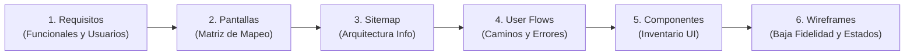

# PRÁCTICA EXPERIMENTAL DE APRENDIZAJE – APE 4
## Fase 1: De los requisitos a la arquitectura de información, navegación y wireframes


---

### Información Académica
- **Institución:** Universidad Técnica de Ambato (UTA)
- **Facultad:** Facultad de Ingeniería en Sistemas, Electrónica e Industrial (FISEI)
- **Carrera:** Ingeniería de Software
- **Docente:** Ing. Mg. José Caiza
- **Caso de Estudio:** **CaféU** — Aplicación web móvil para la gestión y anticipación de pedidos en la cafetería universitaria (taller «¿Confirmar o editar?»).

---

### Integrantes Oficiales del Equipo y Roles

| Integrante | Usuario GitHub | Correo Institucional / Contacto | Rol Oficial en el Proyecto |
|---|---|---|---|
| **Alison Marcela Cobos Taco** | [@Itsuna18](https://github.com/Itsuna18) | tacomarcelab@gmail.com | **Desarrollador Back-End** (Modelos de datos, persistencia, lógica de estado y endpoints) |
| **Melany Saleth Cevallos Goyes** | [@SalyC15](https://github.com/SalyC15) | mcevallos8901@uta.edu.ec | **Desarrollador Front-End** (Vistas, inventario de componentes UI, diseño y wireframes) |
| **Carlos Giovanni Ramos Jácome** | [@carlitosgiovanniramos](https://github.com/carlitosgiovanniramos) | carlos.giovanni.ramos.work@gmail.com | **Tester** (User flows, rutas de error, protocolos de validación y casos de prueba) |
| **Henry Daniel Lagua Flores** | [@Hlagua](https://github.com/Hlagua) | hlagua6116@uta.edu.ec | **QA / Arquitecto** (Arquitectura de información, sitemap, auditorías e informe final) |

---

### Secuencia Metodológica de Diseño Centrado en el Usuario

El proyecto documenta paso a paso la transformación didáctica de las necesidades del usuario en interfaces organizadas y usables:



---

### Estructura de Entregables (`APE4_Fase1`)

Todos los artefactos solicitados por la guía docente se encuentran organizados dentro de la carpeta [`APE4_Fase1/`](APE4_Fase1/):

| N.º | Entregable Oficial | Ubicación en el Repositorio | Descripción |
|---|---|---|---|
| **1** | **Matriz de requisitos, usuarios y pantallas** | [`APE4_Fase1/01_matriz_requisitos_pantallas.md`](APE4_Fase1/01_matriz_requisitos_pantallas.md) | Análisis de tipos de usuario (estudiante y personal de cafetería), 4 funcionalidades clave y trazabilidad a requisitos funcionales (RF-01 a RF-08). |
| **2** | **Sitemap del proyecto** | [`APE4_Fase1/02_sitemap.png`](APE4_Fase1/02_sitemap.png) | Arquitectura de información jerárquica: niveles de navegación (Inicio, Menú, Detalle, Resumen, Modificación, Confirmación, Estado). |
| **3** | **Dos diagramas User Flow** | [`03_userflow_1_realizar_pedido.png`](APE4_Fase1/03_userflow_1_realizar_pedido.png)<br>[`03_userflow_2_modificar_pedido.png`](APE4_Fase1/03_userflow_2_modificar_pedido.png) | Modelado de flujos críticos con caminos felices, puntos de decisión y alternativas ante error (pago rechazado, descarte de cambios, eliminación). |
| **4** | **Esquema de navegación e inventario de componentes** | [`APE4_Fase1/04_esquema_navegacion.png`](APE4_Fase1/04_esquema_navegacion.png)<br>[`04_navegacion_e_inventario_componentes.md`](APE4_Fase1/04_navegacion_e_inventario_componentes.md) | Catálogo de componentes reutilizables (botones con jerarquía visual, cards, selectores Fitts, diálogos) y justificación ergonómica (Hick, Nielsen). |
| **5** | **Wireframes de baja fidelidad (7 pantallas + 4 estados)** | [`APE4_Fase1/05_wireframes/`](APE4_Fase1/05_wireframes/) | Bocetos estructurados de pantallas principales (W1 a W7) y estados críticos (E1 Pago rechazado, E2 Pedido vacío, E3 Agotado, E4 Confirmar eliminación). |
| **6** | **Documento explicativo didáctico** | [`APE4_Fase1/06_documento/APE4_Fase1_CafeU.pdf`](APE4_Fase1/06_documento/APE4_Fase1_CafeU.pdf)<br>[`APE4_Fase1_CafeU.docx`](APE4_Fase1/06_documento/APE4_Fase1_CafeU.docx) | Informe formal en PDF y DOCX con la justificación paso a paso del proceso y respuestas a las preguntas de defensa docente. |
| **7** | **Prototipo Interactivo** | [Prototipo en Figma](https://www.figma.com/proto/0bxGDlHenLKFwC9IroyRXt?node-id=2-4&starting-point-node-id=2%3A4) · [Archivo de Figma](https://www.figma.com/design/0bxGDlHenLKFwC9IroyRXt)<br>[Prototipo en vivo (GitHub Pages)](https://hlagua.github.io/APE4_Fase1/) · [`07_prototipo/index.html`](APE4_Fase1/07_prototipo/index.html)<br>[Wireflow del taller](https://flap-bottom-98029162.figma.site/) | Figma: 13 pantallas de baja fidelidad (W1 – W7, E1 – E4, W4b y W5b) con 39 enlaces y 3 flujos en modo Presentar. HTML: prototipo navegable sin dependencias que simula pedidos, modificaciones y pago rechazado. |
| **8** | **Protocolo de validación y casos de prueba** | [`APE4_Fase1/08_protocolo_pruebas_usabilidad.md`](APE4_Fase1/08_protocolo_pruebas_usabilidad.md) | Casos de prueba CP-01 a CP-05, verificación de heurísticas de Nielsen y métricas proyectadas SUS y SEQ. |

---

### Wireframes Detallados (`05_wireframes/`)

| Código | Pantalla / Estado | Propósito y Usabilidad |
|---|---|---|
| **W1** | **Inicio** | Bienvenida, llamada a la acción «Ver menú», tarjeta del pedido en curso y horario de atención. |
| **W2** | **Menú** | Búsqueda rápida, filtros en chips por categoría y listado de productos con stock visible. |
| **W3** | **Detalle de Producto** | Descripción y precio, opción (Caliente / Frío o Normal / Tostado), selector de cantidad y «Agregar al pedido». |
| **W4** | **Resumen del Pedido** | Desglose completo de ítems, subtotal, lugar de retiro, método de pago y accesos a confirmar o editar. |
| **W5** | **Modificar Pedido** | Modificación en caliente de cantidades, eliminación asistida con modal y recálculo en tiempo real. |
| **W6** | **Confirmación de Compra** | «Pago aprobado», número de pedido #A24, tiempo estimado (10 minutos) y resumen de lo pagado. |
| **W7** | **Estado del Pedido** | Barra de progreso visual por etapas (Recibido → En preparación → Listo para retirar). |
| **E1** | **Pago Rechazado** | Notificación de error no destructiva; conserva el pedido intacto y permite reintentar método de pago. |
| **E2** | **Pedido Vacío** | Estado cero informativo con enlace directo para explorar el menú. |
| **E3** | **Producto Agotado** | Mensaje «Producto agotado» sin opción de agregar y salida «Volver al menú» para elegir otro producto. |
| **E4** | **Confirmar Eliminación** | Diálogo modal que previene pérdidas accidentales de datos (principio de prevención de errores). |

---

### Cómo Ejecutar y Probar el Prototipo

1. Abrir el prototipo en vivo en https://hlagua.github.io/APE4_Fase1/ o, sin internet, el archivo:
   ```bash
   APE4_Fase1/07_prototipo/index.html
   ```
2. **Tareas de usabilidad sugeridas:**
   - **Tarea 1 (Flujo de compra estándar):** Seleccionar un *Café Americano* y un *Sánduche*, avanzar al resumen, confirmar la compra y verificar la pantalla de retiro con tiempo estimado.
   - **Tarea 2 (Modificación de pedido):** Desde el resumen del pedido, presionar «Editar Pedido», aumentar la cantidad del café a 2, eliminar el sánduche mediante confirmación modal y guardar cambios verificando el nuevo total.
   - **Tarea 3 (Resiliencia ante fallos):** En el panel lateral de pruebas del prototipo, marcar la casilla *«Simular pago rechazado»* e intentar confirmar para validar la recuperación del usuario sin pérdida de items.

---

### Repositorio y Contribuciones

- **Repositorio Oficial:** [https://github.com/Hlagua/APE4_Fase1](https://github.com/Hlagua/APE4_Fase1)
- **Prototipo en Figma:** https://www.figma.com/proto/0bxGDlHenLKFwC9IroyRXt?node-id=2-4&starting-point-node-id=2%3A4 (en modo Presentar se elige el flujo 1, el flujo 2 o el estado de pago rechazado).
- Cada integrante registra sus aportes con su propia cuenta de GitHub mediante ramas y Pull Requests revisados por el equipo.
